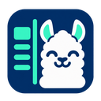

# Ollama Sidebar



**A local AI coding assistant in your VS Code sidebar.** Chat with Ollama models, attach code, and ask the assistant to inspect or modify your project. Ollama runs inference locally; Codex app-server provides the coding tools.

This project was developed with [OpenAI Codex](https://github.com/openai/codex) as a reference and uses its app-server protocol and runtime for agent execution. Ollama Sidebar is an independent project and is not an official OpenAI extension.

[한국어 사용법](https://github.com/startour812-sudo/ollama-sidebar/blob/main/README.ko.md)

## Features

- Stream responses and view command output and file changes.
- Attach the current file or selected code (up to 32 KiB combined).
- Approve or decline action requests and interrupt tasks.
- Save and restore conversations for each workspace.
- Choose installed Ollama models that support tool calling.

## Requirements

- **Windows x64** and **VS Code 1.106.0 or newer**.
- [Ollama](https://ollama.com/) with a tool-capable model; the default is `gemma4:e4b`.
- **Codex 0.150.1**, installed using the setup script below.
- [Node.js](https://nodejs.org/) 22 or newer for setup and source builds.
- A trusted local workspace. WSL, SSH, and virtual workspaces are not supported.

**Installing the extension does not install Ollama, Codex, or model weights.** Complete runtime setup before starting a conversation. The interface currently uses Korean labels; their meanings are explained below.

## Runtime setup

Install Node.js and Ollama, then run these commands in PowerShell:

```powershell
git clone https://github.com/startour812-sudo/ollama-sidebar.git
cd ollama-sidebar
powershell -NoProfile -ExecutionPolicy Bypass -File .\scripts\install-runtime.ps1
ollama pull gemma4:e4b
```

The script downloads the official Codex 0.150.1 Windows npm package to `%LOCALAPPDATA%\SelfAgent\.runtime\vendor`. It reuses a matching installation and stops without overwriting incompatible or incomplete installations. Runtime and model downloads require internet access.

The extension starts a separate Ollama server at `http://127.0.0.1:11435` when needed. To reuse an existing server, set `selfAgent.ollamaUrl` to its loopback address, such as `http://127.0.0.1:11434`.

## Getting started

Install **Ollama Sidebar** from VS Code's Extensions view, or install a VSIX built from source. Open a trusted project folder and run **Ollama Sidebar: 채팅 열기** (Open Chat) from the Command Palette. Select a workspace folder when prompted.

- Click the **model name** to select a model. Switching models saves the conversation and starts a new one.
- Use **파일 첨부** (Attach File) or **선택 코드** (Selected Code) to provide context.
- Press **Enter** to send or **Shift+Enter** for a newline. Enter during Korean text composition does not send.
- Review approval requests before accepting or declining them.
- Use **중단** (Stop) to interrupt a task. Completed file changes remain in place.
- Use **대화 목록** (History) or **＋** to restore a conversation or start a new one.
- Use **로그** (Logs) or the **Ollama Sidebar** output channel to inspect logs.

## Settings and storage

Search for `selfAgent` in VS Code Settings. Existing setting and command IDs are retained for compatibility.

| Setting | Default / purpose |
| --- | --- |
| `selfAgent.ollamaExecutable` | `ollama`; executable name or path |
| `selfAgent.ollamaUrl` | `http://127.0.0.1:11435`; loopback HTTP only |
| `selfAgent.autoStartOllama` | `true`; start the server if unavailable |
| `selfAgent.model` | `gemma4:e4b` |
| `selfAgent.modelCatalog` | Empty uses the bundled catalog; otherwise provide an absolute JSON catalog path |
| `selfAgent.contextLength` | `16384`; match the configuration of an existing server |

Conversations, attached code, logs, and runtime configuration are stored locally in the extension's VS Code `globalStorage`, separated by workspace. Existing `~/.codex` settings are not used. History from the former Self Agent extension is not automatically migrated.

The runtime uses `on-request` approvals, `workspace-write` file access, and the Windows `unelevated` sandbox. Automatically started servers remain available for reuse; idle models unload after five minutes. Image input, web search, plugins, and multiple agents are not supported.

## Build and development

From the repository root:

```powershell
npm ci
npm run check
npm test
npm run build
npm run test:integration
npm run test:live
npm run package
code --install-extension .\artifacts\ollama-sidebar-0.1.5.vsix
```

`check` validates TypeScript; `test` runs Node unit tests; `build` bundles the extension and webview. `package` creates a VSIX under `artifacts/`.

Integration tests use an isolated VS Code host and download VS Code on the first run. Set `SELF_AGENT_TEST_CODE` to a VS Code executable to reuse an installation. Live tests require the runtime and default model and validate file copying, reading, and thread reconnection. They may take several minutes; run them from a normal user terminal to avoid nested Windows sandbox errors.

Open this repository in VS Code and press **F5** to launch the development host. Sources are in `src/`, tests in `test/`, UI assets in `media/`, and model information in `resources/`. `src/protocol/` contains generated Codex types; runtime upgrades require regeneration and integration testing.

## Troubleshooting

- **Runtime missing or wrong version:** run the setup script. Only Codex 0.150.1 is supported; other versions are not replaced automatically.
- **Model missing or unsupported tools:** check `ollama list`, download the model, and select one with the `tools` capability.
- **Server startup failed:** check the executable, configured port, and output logs.
- **Slow first response:** CPU inference and model loading may take several minutes. Keep prompts short and attach only relevant code.
- **Command not visible:** run **Developer: Reload Window**.
- **Nested sandbox failure:** run tests from a normal user terminal.

## License

The extension code is [MIT licensed](LICENSE). See [third-party notices](THIRD_PARTY_NOTICES.md) for generated Codex types and dependencies. Codex, Ollama, and model weights retain their respective licenses and are not included in this repository.
